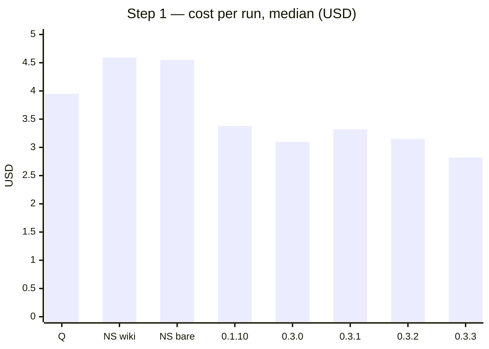
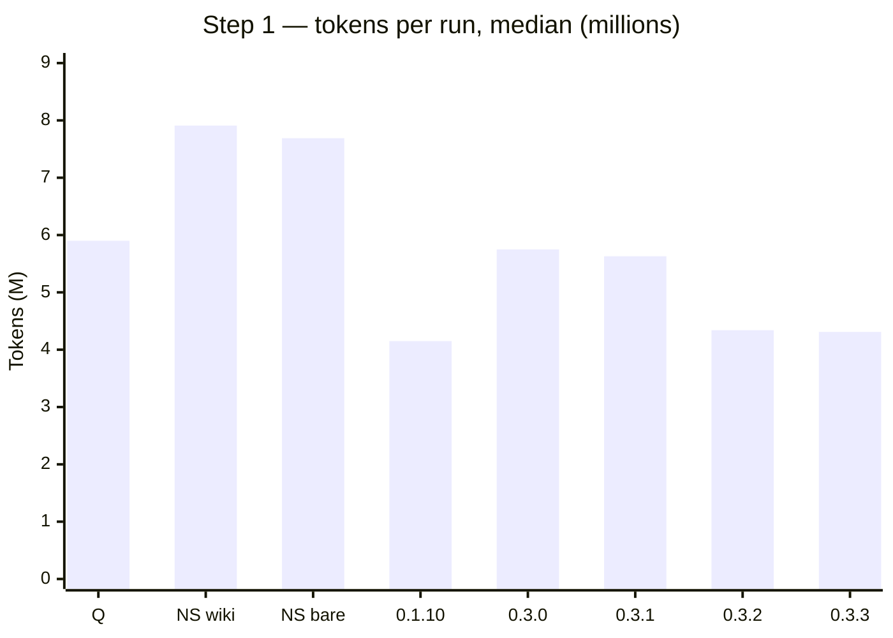
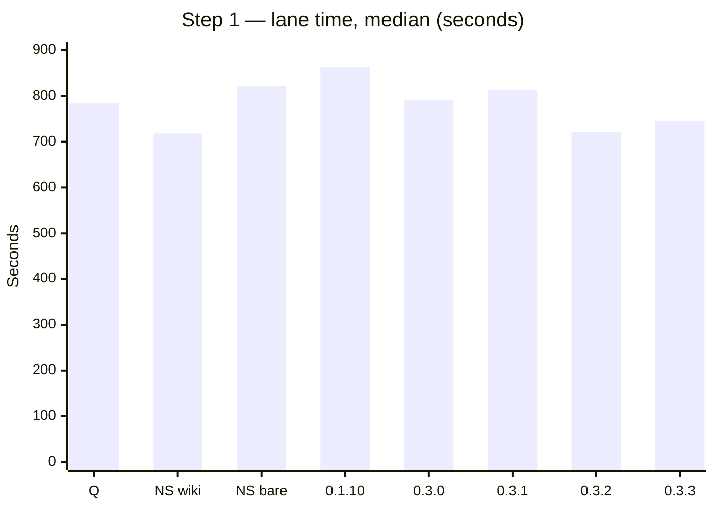
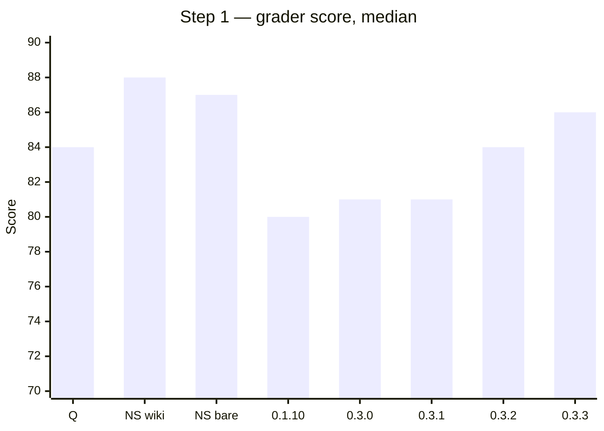

# Light ORC (lorc)

One lean coding skill for Claude Code.


**Latest version:** 0.3.4 — 14-10-2026 · npm: [`@azure-id/lorc`](https://www.npmjs.com/package/@azure-id/lorc)

## What it is

lorc is one skill: `/lorc`. It does one coding request: a fix, a feature or a refactor.
It takes these parts from ORC: the code graph, house rules, wiki, code pattern, executors, orc extra, review, and wait on limit.
When ORC 2.2.0 or newer is installed, lorc calls ORC.
When ORC is not installed, lorc does the same work itself.
lorc has zero runtime dependencies.

## Why

Measured on the company Vue repo, medians of 3 runs, against `/orc-quick` (same main model, Opus 5.5 medium):

- Step 1 (RMT1), lorc 0.3.3 alone: lane time −5 %, cost −29 %, tokens −27 %, score 86 (Q: 84), e2e 3 of 3. It passes the gate.
- Step 1 against plain Claude Code with no skill (1 run per arm): cost −38 % to −39 %, tokens −44 % to −46 %, score 1–2 points lower.
- Step 2 (RMT3), lorc 0.1.10 alone: lane time −28 %, cost −38 %, tokens −38 %, same score (84). With ORC: −43 %, −43 %, −54 %, same score.
- See [Benchmark](#benchmark--light-orc-vs-orc-quick).

## Quick start

**Requirements:** Claude Code, Node.js 18 or newer.

```bash
# 1. Install the CLI from npm
npm i -g @azure-id/lorc
#    or the newest commit from GitHub:
#    npm i -g github:azure-id/lorc

# 2. Install lorc into your project (.claude/)
lorc init
#    or into your user folder (~/.claude/)
lorc init --global

# 3. Optional: make HOUSE-RULES.md in the repo root
lorc rules init
```

Then, in Claude Code:

```
/lorc <your request>
```

Example of a run (an example only, the real text changes per request):

```
Prep:    graph ok · rules card · wiki 2 pages · pattern vue · usage 5h 31 %
Tier:    high — engine 74 % · 2 new components, ~6 source files · cap 3 · groups 2
❓ Put the route under /transfers or /payments? (src/router/index.ts:88)
   a) /transfers (90 %)  b) /payments (30 %)   ➡️ a — the menu already links /transfers
Executor: 1 haiku · 2 sonnet ➡️ · 3 opus low · 4 opus med
Answer, and I start. Nothing runs until you answer.
Build:   lorc-executor-sonnet-5-med — 4 files, tests passed
Check:   lint ok · typecheck ok · review inline, 1 P3 listed
Changed: 4 files · Verified: unit tests, lint · Findings: 1 P3
```

## How a run works

| Step | What happens | Typical tool calls |
|---|---|---|
| L0 PREP | One `lorc prep "<request in English>" --json` call. It starts the run and returns the graph focus, rules card, wiki, pattern, extra slots, settings, usage, a tier hint (only when the table decides), the jev tier judge and lorc's tier engine (`tier_engine`). | 1 |
| L1 DIG | One `lorc graph ctx … --anchors` call, then reads of only the anchored line ranges. At most 1 wiki page. | ≤ 4 |
| L2 TIER | When a key is connected and jev is confident, jev judges the tier. Else lorc's tier engine judges it. Else lorc picks it from the table. lorc prints `Tier: <t> — <jev NN % \| engine NN % \| table> · <evidence> · cap <n> · groups <g>`. | 0 |
| L3 ASK | One message: the intent lock, every open question with a recommendation, the executor menu, a pattern-miss question. With a key, jev rates each option (%). | 0 |
| L4 BUILD | Inline edits (cap 0), or one slice per task and the executors in one message. | 1 per task |
| L5 CHECK + REVIEW | `lorc check --run <slug> --review --json` (or `--lint-only` when the executor tests passed), then the review: inline or the reviewer agent. P0/P1 are fixed, P2/P3 are listed. | 1–3 |
| L6 FINISH | `lorc run end`: graph update, run record, at most one habit proposal. A reply of at most 12 lines. | 1 |

**The hard gate.** lorc never assumes. A fact that the code, the prep output or you did not give is a question in L3.
lorc asks until nothing is assumed. No code is written before your answer.

## Task tiers and subagents

| Tier | Signals | Subagents (auto) |
|---|---|---|
| low | ≤ 2 files, 1 area, no new module | 0 — lorc edits inline |
| mid | 3–5 files, or 1 new component in 1 area | ≤ 1 |
| high | 6–20 files, ≥ 2 new components, or 2–3 independent areas | ≤ 3 |
| complex | > 20 files, > 3 areas, ordered steps, a migration | ≤ 5 + a checkpoint after each wave |

- Work with ≥ 6 files or ≥ 2 new components is split into 2–3 disjoint groups. No file is in two groups. The groups run at the same time.
- `dispatch: auto` (default): lorc starts the executors. `dispatch: manual`: lorc asks first, and the cap is `dispatch_max`.
- `dispatch_max`: the most executors at the same time, `1`–`5` or `off` (no executors). Default `5`.

### Tier engine (lorc's own)

`lorc tier "<request>" [--doc <path>] [--json] [--brief] [--no-history]` is lorc's own tier engine. It is deterministic: one repo state and one request give one answer. It reads; it never writes code. It gives the tier, a score, the confidence, the cap, the split, the executor and the evidence lines.

**The order in `lorc prep`.** 1. jev, when a key is connected and jev is confident. 2. The engine (`tier_judge.by = "engine"`, with the reason jev did not decide). 3. The table, only when `tier_engine: off` or the engine fails. jev gets the engine's evidence as words (estimated source files, new components, areas, callers, similar commits, mechanical), never the engine's tier. The prep JSON has a compact `tier_engine` (tier, score, conf, cap, groups, est_files, executor, why ≤ 3, split). `prep.json` in the run folder keeps the full answer. `lorc prep` also takes `--doc <path>` (a requirement doc). When the request adds a page or a route and the repo has a router, the prep JSON has `must_ask[]`: `{ q, seen: [{ path, at[] }] }`. The skill asks the user about each item and does not pick the value itself.

**Signals.**
- Request text: new-file units (page, component, modal, endpoint, service, model …) against element edits (button, field, column …), named targets (`code`, CamelCase, paths), wiring verbs, layers, risk classes, and cues (mechanical, signature, refactor, migration, ordered, state, algorithm). A requirement doc adds lines, items and API calls.
- Code graph: core files, named symbols with their callers and the files that import them (blast radius), the feature folder, router and API-client files, locale and test files, layers, project folders. A generic component that exists already is reused, not new.
- Git history (cached by HEAD in `.claude/lorc/tier/git.json`): the units that landed on the main line (`git log --first-parent -m`): a squash or direct commit, or a whole merged PR (all its files). Commits inside a PR branch are not units. A merge's subject is the PR title plus the branch words. Dashboard repo: 1,003 units (242 merged PRs) instead of 2,921 commits, read in 0.26 s. Signals: co-change partners (conf ≥ 0.6, support ≥ 3, at most +3), similar past changes (median source files), and the wiring ratio (existing files changed per new file, learned; default 2).
- lorc's finished runs: the final tiers of similar requests (Wilson lower bound ≥ 0.55, in practice 5 of 5 agreeing runs → move one band) and their source-file counts.

**Self-calibration.** `lorc run end` copies the engine's answer from `prep.json` into the run record: `engine_tier`, `est_files`, `est_raw` (the estimate before calibration) and `jev_tier` (when jev decided). After 5 finished runs with a real size (`src_files`) and `est_raw`, the engine multiplies its estimate by the median of real ÷ raw over the last 30 runs (clamped 0.5–2; used only when it differs from 1 by 0.1 or more). The evidence says `calibrated ×<f> from <n> runs`. The engine learns from the raw estimate, never from its own calibrated output. `lorc tier eval` shows the factor (`calibration:` line; `calibration` in `--json`).

**Files and guards.** The engine counts SOURCE files. Tests, locale files, docs and lock files do not count (tests and 2 locale files are 2–4 of every UI change). The table rows do not change. The highest row that a signal reaches wins. A migration or ordered steps with no data-layer evidence → high, not complex. With data-layer evidence, a migration is complex only for a DATA migration (backfill, split, merge, rename, drop, convert a format) or a big change; a small schema migration (add a column, an index) → high. A mechanical change (rename, signature) with no new file → mid at most (one executor). Types (class, struct, interface, trait, enum, protocol) often share one file: two count as one new component.

**Languages.** The text, git-history and run-history signals do not depend on the language. The code graph reads JS, TS, Vue, Python, Go, Java, Kotlin, C#, PHP, Ruby, Rust and C. The path rules (layers, routers, project folders, tests, locale files, lock and generated files) cover Django, FastAPI, Go, Spring, Android, ASP.NET, Rails, Laravel, Rust, iOS and Flutter layouts. Type names count as their kind (`OrderSerializer` → serializer, `PaymentService` → service). Swift and Dart have no graph: the engine uses the text and the history only. The skill gives the request to prep in English (L0). The parser also reads Indonesian: request verbs (tambah, buat, ubah, ganti, perbaiki, hapus, hubungkan …), nouns as their English kind (halaman → page, komponen → component, tombol → button …), plurals such as `halaman-halaman`, and cues and risk words (migrasi, pembayaran, kata sandi …). Example: "tambah halaman detail pesanan dengan tombol batal" → 1 new page + 1 element edit → mid (before: nothing found). The measured numbers below come from one Vue repo.

**Graph or git.** `lorc tier "<request>"` builds the code graph when there is none, else updates the changed files: the same step `lorc prep` runs. `--no-heal` skips it. prep gives the engine `--no-heal` because prep did this step already. `lorc tier eval --recompute` also heals first. With no graph (`--no-heal` or a failed build), or a graph that finds no related file (a language it does not read, such as Swift or Dart), the engine takes the same facts from git. The parts of a resolved name (`OrderService` → order, service) find files by the name only, not by path words. Related files are tracked source files whose path holds a request word that few paths use (the same rarity weight as the graph's focus words), ranked by that weight, then by how often git changed them. For a named symbol, `git grep` finds its definition and the files that use the name (blast radius). The feature folder, wiring files, router, co-change and the other signals then work as with the graph. Related files from paths add less confidence (+8 points; the graph adds +15). The evidence says `no graph (<reason>): related files from git paths`; `--json` shows `detail.graph.source` (`graph` or `git`). Not a git repo and no graph: text and run history only, `no graph: <reason>`. Measured on the dashboard repo (step 2, with the doc): graph → high, ~10 files, 74 %; no graph before → mid, ~5, 41 %; git part → high, ~10, 67 %, in about 0.3 s against 1 s.

**Confidence** is 10–95 %. It comes from the margin inside the band and the evidence (the graph found core files, the analogs agree, history).

**Split.** For high and complex: 2–3 disjoint groups by project, then by layer, else by new component (the page and its wiring first).

**Executor.** ORC's facet formula on the estimated facets (B + N + L + T + fan + U, risk floor 70): haiku-5-high < 30 · sonnet-5-med < 65 · opus-5-low < 90 · else opus-5-med. The low tier is inline. A cheaper executor with clean runs at the tier wins when its Wilson lower bound is ≥ 0.55 (in practice 5 of 5 clean runs). In L3, ➡️ is on `tier_engine.executor`, unless L1 shows that it cannot do the work.

**History and eval.** `lorc run end` records `files_changed` and `src_files` (files changed during the run; files dirty at the start do not count) and `tier_by` (`jev`, `engine` or `table`). `lorc tier eval [--recompute] [--json]` measures the engine and jev against the finished runs.

**Measured.** On the eval sandboxes (dashboard repo, 12 lorc runs, the requirement doc given): estimated against real source files, the mean absolute error is 0.92 files. Without the doc it is 1.58. Step 1 (route shell + step) → high, the same as the model's pick, ~6 files against 5–6 real. Step 2 (one new step in the existing wizard) → mid, ~5 against 5–7 real (the model picked high). The sample is small: run `lorc tier eval` on your own repo.

Example of the output (the evidence lines change per request):

```
$ lorc tier "add the transfer page with a confirm step" --doc docs/transfer.md
Tier: high — engine 74 % · score 58 · cap 3 · groups 2 · executor sonnet-5-med
  <evidence line>
  <evidence line>
  G1 ui: <units>
  G2 <layer>: <units>
  executor formula <facets>
```

**Why.**
- SWE-bench / Multi-SWE-bench: no predictor finds the size before the solve from the issue text alone.
- ROSE (Zimmermann et al. 2004): co-change predicts more files.
- Story-point replications: median and analogy baselines are strong; the requirement length helps.
- LLM routers: rules first, then check them on your own data.

### Tier judge (TypeSafe jev)

TypeSafe jev is a "System One" model (https://docs.typesafe.ai). It does not write text. It returns typed decisions (Choice, Score, Noul) with calibrated probabilities and a confidence value. lorc uses jev as the L2 tier judge. When a key is connected, `lorc prep` asks jev for the tier. The answer is in the prep JSON as `tier_judge`.

**Connect.** Get a key at https://console.typesafe.ai/keys. Then do one of these:

```bash
# 1. Set the key in the environment (or in the "env" block of ~/.claude/settings.json)
export TYPESAFE_API_KEY=<your key>
# 2. Save the key. The key comes on stdin, so it is not in the shell history.
lorc jev connect - < key.txt
```

- `lorc jev connect` checks the key with `GET /v1/models` first. `--no-check` skips the check. The key goes to `~/.claude/lorc/jev.json` in your user folder, never into the project (file mode 600 on macOS/Linux).
- The env key wins over the saved key. `lorc jev status [--ping] [--json]` shows the state. It shows only `…` and the last 4 characters of the key. `lorc jev disconnect` removes the saved key.
- Optional env: `TYPESAFE_BASE_URL` (default `https://api.typesafe.ai`) and `TYPESAFE_DEFAULT_MODEL` (default `jev-latest`). Pin a version such as `jev-1.13.0` to keep the answers stable.

**What lorc sends.** One `POST /v1/systemone` per run: the request text (≤ 600 characters), at most 8 focus file paths, the file and area counts as words, the risky paths, and "new files likely" yes/no. lorc never sends file content. The key goes only in the `Authorization: Bearer` header and only over https. Plain http is for localhost only (tests). lorc refuses all other base URLs.

**The questions.** One call asks the tier Choice (low, mid, high, complex) two times, with the options in opposite order. jev leans to the first option, so lorc averages the two answers. The call also asks 4 yes/no signals: `new_component`, `migration`, `ordered_steps`, `multi_area`. lorc computes the tier and the confidence in code. A tie goes to the higher tier.

**Confidence gate.** Below `tier_judge_min_conf` (default 60), the built-in table decides. prep shows the jev pick as a hint, for example `tier judge: table (low confidence; jev mid 42 %)`.

**Fallback.** Then lorc's tier engine decides (`tier_judge.by` is `engine`, with the reason). Only when `tier_engine` is `off` or the engine fails, `tier_judge.by` is `table`, and the skill picks the tier from the table with `tier_hint`. prep puts `tier_hint` in its JSON only in this case. A jev failure never stops a run.

| Reason | What happens |
|---|---|
| `no key`, `off` | the table decides; no network call and no extra process |
| `base URL must use https` | no call; the table decides |
| `http <status>`, `timeout` (5 s; one retry on 429/529), `network`, `bad response`, `judge failed` | the table decides |
| `low confidence` | the table decides; prep shows the jev pick as a hint |

**Raise one row.** With `by = jev`, the tier is the jev tier. The main session can raise it one row only when L1 found a fact of a higher row that jev did not see. It names the fact. It never lowers the tier. `lorc run end` records `tier_by` (`jev` or `table`). `prep.json` in the run folder keeps the full jev answer.

**Cost.** TypeSafe lists $0.042 per million input tokens and free output tokens (12-10-2026). One call uses a few thousand input tokens at most, so a run costs less than $0.001.

### Option judge (L3 questions)

With a key connected (the same key as the tier judge), jev also rates the options of each L3 question. Example: `a) /transfers (90 %)  b) /payments (30 %)   ➡️ a — the menu already links /transfers`.

**The flow.** prep returns `ask_judge: false` or `ask_judge: { how }`. It returns `how` when the `ask_judge` setting is `auto`, a key exists and the base URL is https (or localhost). `how` is the exact `lorc jev ask --run <slug> --json -` command with the JSON shape. SKILL.md L3 only says: `ask_judge.how` set → do it first. The skill pipes its questions to the command (JSON on stdin) before the L3 message:

```json
{"intent":"…","questions":[{"id":"q1","q":"…","facts":"<file:line — fact>","options":{"a":"…","b":"…"}}]}
```

`--run` adds the run's request and appends the answer to `asks-jev.jsonl` in the run folder.

**The questions.** jev gets one yes/no question (Noul) per option: "is this option the right answer for the request?". Each Noul sees the question, the facts and all the options, so it rates the option against the others. Each percentage is independent: the percentages do not add up to 100 %.

**The recommendation.** `rec` is the top option only when it is at least 50 % and at least 10 points over the next option. Else `rec` is null: jev is not sure, and the main session puts ➡️ on its own pick. The session shows the percentages in both cases.

**Limits.** At most 10 questions and 8 options per call. Option keys are 1–8 letters or digits. lorc cuts the question text at 400, the facts at 600 and each option at 300 characters.

**Fallback.** The answer is `{ by: "self", reason }` for `no key`, `off`, `base URL must use https`, `no questions`, `http <status>`, `timeout`, `network` or `bad response`. Then the session recommends alone, the same as before 0.2.0, with no percentages.

**Cost.** One more jev call per L3 round, the same price as the tier call (less than $0.001).

## Executors

| Agent | Model id | Effort | Use it for |
|---|---|---|---|
| `lorc-executor-haiku-5-high` | `claude-haiku-5-5` | high | mechanical work |
| `lorc-executor-sonnet-5-med` | `claude-sonnet-5-5` | medium | normal feature work |
| `lorc-executor-opus-5-low` | `claude-opus-5-5` | low | cross-module work, tricky state |
| `lorc-executor-opus-5-med` | `claude-opus-5-5` | medium | hard logic, security |
| `lorc-reviewer-opus-5-low` | `claude-opus-5-5` | low | the review of large or risky diffs |

- lorc recommends the cheapest executor that can do the task. It asks you only when it dispatches and `executor` is `ask`.
- An `extra:<slot>` choice shows for each ORC extra slot.
- `executors: all` installs the other models too: `haiku-4-5`, `sonnet-4-6-med`, `sonnet-4-6-high`, `sonnet-5-high`, `opus-4-7-med`, `opus-4-7-high`, `opus-4-8-high`, `opus-5-high`.
- `/lorc-wiki` uses `lorc-wiki-scanner-opus-5-low` and `lorc-wiki-scanner-sonnet-5-high`. `/lorc-pattern` uses `lorc-pattern-codifier-sonnet-5-high`.

## Works with ORC

**The delegate rule.** When ORC 2.2.0 or newer is installed, lorc calls `orc graph`, `orc wiki`, `orc pattern` and `orc extra`.
lorc checks each result. When a call fails, lorc uses its own path.

**Shared files.** lorc and ORC use the same files:

| What | Path |
|---|---|
| Code graph store | `.claude/orc/graph/` |
| Wiki | `wiki/` |
| Code patterns | `.claude/orc/patterns/` |

**The daily graph copy.** `lorc prep` runs `lorc graph sync --if-older 24`. This copies ORC's graph store to `.claude/lorc/copy/` when the copy is older than 24 hours.
lorc reads the copy when ORC's store has a different engine version.

**ORC 2.3.0** shows lorc in `orc ui` (the Light ORC panel) and has the `orc lorc …` commands.

## House rules and anti-slop

- `lorc rules init` writes `HOUSE-RULES.md` in the repo root, with the levels P0, P1, P2 and P3.
- `HOUSE-RULES.md` beats every other rule.
- The rules card holds: your house rules, the P0 rules of the project `CLAUDE.md`, and ORC's code and delivery anti-slop rules. `lorc rules card` writes it to `.claude/lorc/rules-card.md`.
- `lorc rules show` prints the rules. `lorc rules lint [--diff]` checks the code with zero tokens.
- In the review, a broken house rule moves one level: rule P0 → P1, rule P1 → P2, rule P2/P3 → P3.

## Wiki and code pattern

- lorc reads at most 3 wiki page paths from prep, and the build, test and lint commands. L1 reads at most 1 page.
- lorc reads the code pattern file only when the work is in its language.
- `/lorc-wiki` builds the wiki. `/lorc-pattern` builds the code pattern. Both use ORC's file format.
- When no pattern matches and `pattern_miss` is `ask`, lorc asks one yes/no question: learn the pattern first?

## Usage limit and the status line

- `lorc usage` shows the 5-hour, weekly and context usage. Exit code: `0` ok or unknown · `1` limit · `3` weekly.
- At `limit_pct` (default 90 % of the 5-hour window), lorc waits for the reset. `lorc wait` waits with zero tokens.
- At `limit_weekly_pct` (default 98 % of the weekly window), lorc writes a RESUME file and stops.
- `lorc cli bypass` sets the lorc status line. `lorc cli restore` puts back the old one. `lorc cli status` shows which one is active.

The status line shows:

```
ctx <n>% · 5h <n>% · reset <n>m · wk <n>%
```

When ORC is installed and `statusline_writes_orc` is `true`, the status line also writes ORC's usage file.

## Behaviour learning

- lorc records your answers to its questions in `.claude/lorc/behaviour.jsonl`.
- From these records, lorc can make a habit proposal. It uses ORC's rule: at least 5 records, a Wilson lower bound of 0.55, and the last 3 records agree.
- lorc never applies a habit without your yes.
- `lorc habits` lists the proposals. `lorc habits accept <id>` and `lorc habits decline <id>` answer them.
- The `habits` setting: `off`, `observe` (default) or `propose`.

## Settings

Set a value with `lorc settings set <key> <value> [--global]`. Show all with `lorc settings`.
A project value beats a global value.

| Key | Default | Allowed values | What it does |
|---|---|---|---|
| `dispatch` | `auto` | `auto`, `manual` | auto = lorc starts executors; manual = lorc asks first |
| `dispatch_max` | `5` | `off`, `1`–`5` | most executors at the same time |
| `limit_pct` | `90` | integer 50–99 | stop at this used % of the 5-hour window |
| `limit_weekly_pct` | `98` | integer 50–100 | stop at this used % of the weekly window |
| `executor` | `ask` | `ask`, `haiku-5-high`, `sonnet-5-med`, `opus-5-low`, `opus-5-med` (+ the others with `executors: all`) | the executor model |
| `executors` | `core` | `core`, `all` | core = 5 executor choices; all = every model |
| `tier_judge` | `auto` | `auto`, `off` | auto = jev picks the tier when a key is connected; off = the built-in table only |
| `tier_engine` | `auto` | `auto`, `off` | auto = lorc's tier engine decides when jev does not; off = the model reads the tier table |
| `tier_judge_min_conf` | `60` | integer 0–99 | the lowest jev confidence (%) lorc accepts |
| `ask_judge` | `auto` | `auto`, `off` | auto = jev rates each L3 option when a key is connected; off = lorc recommends alone |
| `review` | `auto` | `auto`, `inline`, `agent` | how lorc reviews the change |
| `review_agent_min_lines` | `400` | integer 50–5000 | auto review uses an agent from this many changed lines |
| `pattern_miss` | `ask` | `ask`, `on`, `off` | what to do when no code pattern matches |
| `extra` | `auto` | `auto`, `off` | use ORC extra providers when ORC has them |
| `habits` | `observe` | `off`, `observe`, `propose` | habit capture level |
| `house_rules_warn_kb` | `4` | integer 1–64 | warn when house rules are bigger than this (KB) |
| `review_mute` | `""` | comma list of `a-z` and `-` | finding categories lorc does not list at P2/P3 |
| `statusline_writes_orc` | `true` | `true`, `false` | the status line also writes the ORC usage file |

## Command reference

| Command | What it does |
|---|---|
| `lorc help` | print the usage |
| `lorc version` | print the lorc version (`--json` for one JSON object) |
| `lorc settings` (`setting`) | show, set or reset lorc settings |
| `lorc init` | install lorc into `.claude` (no overwrite) |
| `lorc update` | reinstall lorc files (overwrite); `--prune` removes orphans |
| `lorc prune` | same as `update --prune` |
| `lorc where` | print the install and data paths |
| `lorc doctor` | check the install; `--fix` repairs |
| `lorc upgrade` | `npm i -g @azure-id/lorc@latest`, then update |
| `lorc changelog` | versions newer than the installed one |
| `lorc usage` | 5h, weekly and context usage and the limit gate |
| `lorc wait` | wait for the 5h window reset (zero tokens) |
| `lorc cli` | `bypass`, `restore`, `status` of the status line |
| `lorc run` | run record: `checkpoint`, `end`, `resume`, `list`, `show` |
| `lorc habits` | habit proposals; `accept` or `decline <id>` |
| `lorc stats` | tokens and cost per finished run |
| `lorc graph` | code graph: `where`, `status`, `update`, `ctx`, `map`, `changes`, `sync` |
| `lorc wiki` | `status`, `sync`, `pick "<words>"`, `commands` |
| `lorc pattern` | code pattern `status [<lang>]`, `show <lang>` |
| `lorc rules` | house rules: `init`, `show`, `card`, `lint [--diff]` |
| `lorc extra` | extra executors: `status`, `list`, `dispatch --slot <s> --slice <path>` |
| `lorc prep` | `prep "<request>" [--json] [--no-start]`: the one L0 call of `/lorc` |
| `lorc slice` | `slice --run <slug> --task <n> -`: write an executor slice (JSON on stdin) |
| `lorc check` | `check --run <slug> [--lint-only] [--build] [--full]`: affected tests, lint, typecheck |
| `lorc cov` | `cov [--bar <n>] [--json] [--dir <repo>]`: coverage of the changed source files from the lcov data (no test run); exit 1 when the bar is not met |
| `lorc review` | `review prep --run <slug> [--tier <t>]`: write the review packet |
| `lorc tier` | `tier "<request>" [--doc <path>] [--json] [--brief] [--no-heal]`: lorc's tier engine · `tier eval [--recompute]` |
| `lorc jev` | `status [--ping]`, `connect -`, `disconnect`, `tier`, `ask [--run <slug>] -`: the TypeSafe jev judges |

**Coverage: source and generated branches.** A transform (Babel, TS) adds branches that the source map puts on an import line or on a helper function line. These arms are not in the code that you wrote. `lorc cov` counts them as `generated` and judges the bar on lines and source branches (`src_branches`). For a file that existed at HEAD, it judges only the added lines (`changed`). Example: `AmountAndMethod.vue` raw branches 83.33 % → source branches 100 % (2 uncovered arms on an import line). A real gap stays a gap: the uncovered source lines are listed. When the source map of an SFC covers only a small part of its script, `lorc cov` sets `tool_limit`. This is a fact about the tooling. It is not a finding, and the review packet tells the reviewer so.

## Files lorc writes

| Scope | Path | What |
|---|---|---|
| Project | `.claude/lorc/settings.json` | project settings |
| Project | `.claude/lorc/run/<slug>/` | run state, `checkpoint.json`, `RESUME.md` |
| Project | `.claude/lorc/runs.jsonl` | finished runs |
| Project | `.claude/lorc/behaviour.jsonl`, `habits-state.json` | behaviour records and habit answers |
| Project | `.claude/lorc/rules-card.md` | the rules card |
| Project | `.claude/lorc/usage.json` | the status-line usage reading |
| Project | `.claude/lorc/tier/git.json` | the git-history cache of the tier engine |
| Project | `.claude/lorc/copy/` | the copy of ORC's graph store |
| Project | `.claude/lorc/coverage/` | coverage output of `lorc check` |
| Global | `~/.claude/lorc/settings.json` | global settings |
| Global | `~/.claude/lorc/jev.json` | the saved TypeSafe key (`lorc jev connect`) |
| Repo root | `HOUSE-RULES.md` | your house rules |

## Benchmark — Light ORC vs /orc-quick

**Method.** Company Vue repo. 3 runs per cell. The table shows medians. The main model is the same in every arm: Opus 5.5 medium. ORC 2.3.0 freeze. Date: 11–14-10-2026.
`/orc-quick` uses its pinned executor, Opus 5.5 low. lorc picks its own executor.
Arms: Q = `/orc-quick`. LS = lorc alone. LO = lorc with ORC installed.
Gate per cell: cost lower AND tokens lower AND lane time lower AND score median not lower than Q AND the critical e2e steps pass in 3 of 3 runs.

### Step 1 (RMT1) — lorc 0.3.x, `/orc-quick` and no skill

Arms: Q = `/orc-quick` (3 runs). LS = lorc alone (3 runs per version). No skill = plain Claude Code, same model and
effort, no lorc and no ORC: "wiki" keeps the committed wiki and CLAUDE.md, "bare" removes the wiki (1 run each).

| Arm | Lane s | Cost $ | Tokens | Fresh | Score | E2E pass |
|---|---|---|---|---|---|---|
| Q (`/orc-quick`) | 785 | 3.95 | 5.90M | 302.3k | 84 | 3/3 |
| No skill, wiki | 718 | 4.59 | 7.91M | 291.0k | 88 | 1/1 |
| No skill, bare | 823 | 4.55 | 7.69M | 277.8k | 87 | 1/1 |
| LS 0.1.10 | 864 | 3.38 | 4.15M | 333.0k | 80 | 2/3 |
| LS 0.3.0 | 792 | 3.10 | 5.75M | 358k | 81 | 3/3 |
| LS 0.3.1 | 813 | 3.32 | 5.63M | 366k | 81 | 3/3 |
| LS 0.3.2 | 721 | 3.15 | 4.34M | 349k | 84 | 2/3 |
| **LS 0.3.3** | **746** | **2.82** | **4.31M** | **332k** | **86** | **3/3** |

The same medians as charts (Q = `/orc-quick`, NS = no skill). Lower is better for cost, tokens and lane time; higher is
better for the score.









lorc 0.3.3 compared with each arm (lane / cost / tokens / score):

| Against | Lane | Cost | Tokens | Score |
|---|---|---|---|---|
| Q (`/orc-quick`) | −5 % | −29 % | −27 % | +2 |
| No skill, wiki | +4 % | −39 % | −46 % | −2 |
| No skill, bare | −9 % | −38 % | −44 % | −1 |
| LS 0.1.10 | −14 % | −17 % | +4 % | +6 |

**Gate (RMT1, LS 0.3.3 vs Q): PASS** — cost, tokens and lane time lower, score not lower, e2e 3 of 3. This is the first
pass on step 1.

0.3.3 runs: 805 s / $2.89 / 4.31M / 86 · 746 s / $2.82 / 4.51M / 88 · 692 s / $2.50 / 3.70M / 84. All 3 asked the route
path in L3 and chose `outwards/create`. All e2e runs passed 12 of 12 steps and 30 of 30 checks.

What changed from 0.3.0 to 0.3.3, and why:
- 0.3.1: `lorc cov` splits source branches from generated branches. The 0.3.0 runs lost points in 3 of 3 runs to a
  branch-coverage number (83.33 %) that came from Babel helper code on an import line. 0.3.1: 0 of 3.
- 0.3.2: a broken source map is a `tool_limit`, not a finding. In one 0.3.1 run the reviewer read it as "coverage not
  proven" and the lane spent a whole turn measuring coverage (7.37M tokens). Also: an unmet acceptance item is P1, and an
  executor never deletes a failing test.
- 0.3.3: prep `must_ask` gives the route path of a new page as a required question, with the paths that the repo already
  names (router comment, tests). One 0.3.2 run, and one 0.1.10 run, made up a route path, and the e2e failed.

Limits of this comparison:
- The no-skill arms ran once each, in an earlier round of the same kit, with an older check set (26–27 checks; now 30).
  The model, the effort and the Claude Code version (2.1.288) are the same. Read their scores as approximate.
- lorc uses more FRESH input tokens than plain Claude Code (332k against 278k–291k). It saves on cache reads.
- A second grade of the same run moved the score by up to 3 points.

Version measured in the table below: 0.1.10 (both steps).

| Step | Arm | Lane s | Cost $ | Tokens | Fresh | Peak ctx main / agent | Turns | Subagents | Score | E2E pass | Δ lane / cost / tokens / score vs Q | Gate |
|---|---|---|---|---|---|---|---|---|---|---|---|---|
| RMT1 | Q | 785 | 3.95 | 5.90M | 302.3k | 108.4k / 143.7k | 3 | 1 | 84 | 3/3 | — | — |
| RMT1 | LS | 864 | 3.38 | 4.15M | 333.0k | 77.6k / 130.1k | 3 | 4 | 80 | 2/3 | +10 % / −14 % / −30 % / −4 | FAIL |
| RMT1 | LO | 740 | 3.60 | 4.79M | 419.4k | 98.6k / 135.3k | 2 | 4 | 76 | 2/3 | −6 % / −9 % / −19 % / −8 | FAIL |
| RMT3 | Q | 962 | 4.09 | 6.65M | 291.8k | 116.6k / 116.4k | 3 | 1 | 84 | 3/3 | — | — |
| RMT3 | LS | 690 | 2.52 | 4.10M | 285.1k | 71.6k / 124.2k | 2 | 2 | 84 | 3/3 | −28 % / −38 % / −38 % / 0 | PASS |
| RMT3 | LO | 546 | 2.34 | 3.04M | 285.9k | 85.2k / 114.2k | 2 | 2 | 84 | 3/3 | −43 % / −43 % / −54 % / 0 | PASS |

**Gate verdicts.** RMT3 LS PASS · RMT3 LO PASS · RMT1 LS FAIL (time, score, e2e) · RMT1 LO FAIL (score, e2e).

RMT1 fails for two reasons. One LS run put the route on a path that the request did not ask for. One LO run used an SCSS variable that does not exist, so the app did not start.

**Earlier versions** (score per run, PASS count):

| Version | Step | LS scores | LO scores |
|---|---|---|---|
| 0.1.8 | RMT1 | 85, 84 (2 PASS of 2) | 82, 82, 83 (3 PASS of 3) |
| 0.1.10 | RMT1 | 80, 58, 83 (2 PASS of 3) | 76, 83, 45 (1 PASS of 3) |
| 0.1.9 | RMT3 | 85, 87, 81 (3 PASS of 3) | 82, 72 (1 PASS of 2) |
| 0.1.10 | RMT3 | 84, 85, 84 (3 PASS of 3) | 85, 84, 77 (2 PASS of 3) |

0.1.8 has the better quality on RMT1. On RMT3, 0.1.9 and 0.1.10 are almost equal.

**About later versions.** Step 1 was re-run on 0.3.0–0.3.3 (table above). Step 2 (RMT3) and the LO arm are not re-run after 0.1.10.

**Grader noise.** A second grade of the same run moved the score by up to 3 points. Gaps of 1–3 points are inside the noise.

The raw data is in the eval kit.

## Development

```bash
npm test               # the node:test suite
npm run verify         # the package integrity check
npm run vendor         # copy the ORC engine files from ../orc (hash pinned)
npm run build:agents   # generate the executor agents from agents-src/executor.template.md
```

- Never edit `vendor/` by hand. Run `npm run vendor`.
- Never edit the generated executor files. Edit `agents-src/executor.template.md`, then run `npm run build:agents`.

## Changelog

### 0.3.4 — 14-10-2026
Docs only. The README benchmark shows the step 1 (RMT1) results of lorc 0.3.0–0.3.3 against `/orc-quick` and plain Claude Code with no skill. lorc 0.3.3 passes the step-1 gate.

<details><summary>History</summary>

- 0.3.3 — prep `must_ask[]`: ask the route path of a new page, never pick it
- 0.3.2 — coverage tool limit is "NOT a finding"; an unmet acceptance item is P1
- 0.3.1 — `lorc cov`: source branches apart from generated branches
- 0.3.0 — lorc's own deterministic tier engine (`lorc tier`)
- 0.2.0 — TypeSafe jev judges the tier and rates the L3 options
- 0.1.11 — The L5 fix-round paragraph is back to the 0.1.8 text
- 0.1.10 — No SendMessage: a P0/P1 fix larger than 10 lines goes to one new executor
- 0.1.9 — After `lorc check` the main session never runs tests, coverage or builds
- 0.1.8 — Coverage output under the repo-root `.claude/lorc/`, not inside a sub-project folder
- 0.1.7 — Executor edits only with the Edit and Write tools
- 0.1.6 — Eval round 7 fixes: tests in a sub-project folder, graph-first dig, short reply
- 0.1.5 — Eval round 6 fixes: the project P0 rules and the coverage bar reach the executor
- 0.1.4 — Eval round 5 fixes: parallel split and reference code in the slice
- 0.1.3 — Eval round 4 fixes: no duplicate test work after the executor
- 0.1.2 — Eval round 3 fixes: slice known facts, one call for check and review
- 0.1.1 — Eval round 2 fixes: usage exit code, slice refs, executor test runs, L5 lint-only check
- 0.1.0 — Repo skeleton, vendor script

</details>

## License

MIT
