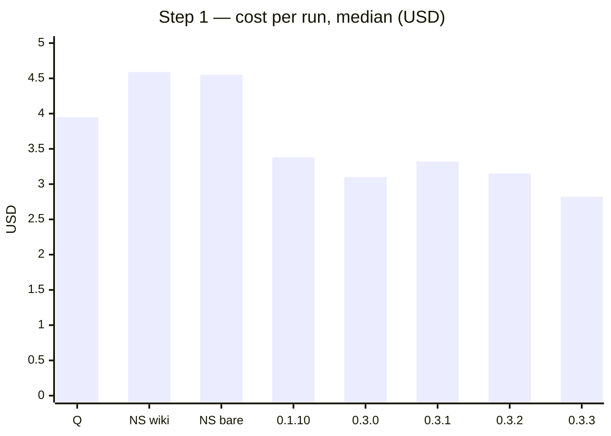
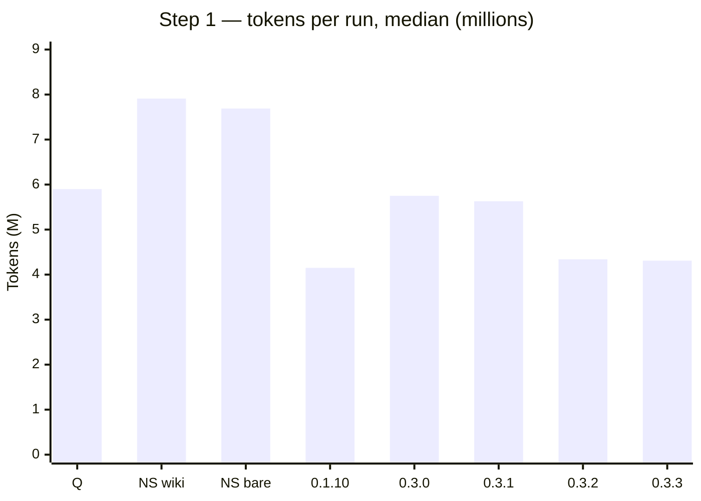
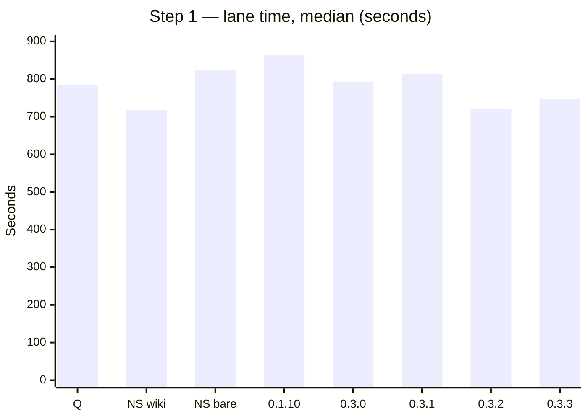
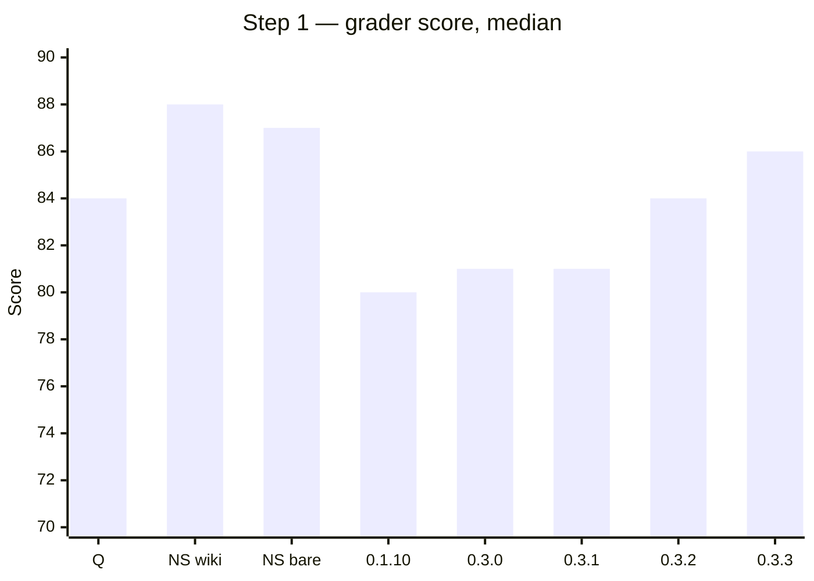

# Benchmark — Light ORC vs /orc-quick

[← README](../README.md)

**Method.** Company Vue repo. 3 runs per cell. The table shows medians. The main model is the same in every arm: Opus 5.5 medium. ORC 2.3.0 freeze. Date: 11–14-10-2026.
`/orc-quick` uses its pinned executor, Opus 5.5 low. lorc picks its own executor.
Arms: Q = `/orc-quick`. LS = lorc alone. LO = lorc with ORC installed.
Gate per cell: cost lower AND tokens lower AND lane time lower AND score median not lower than Q AND the critical e2e steps pass in 3 of 3 runs.

## 0.5.x — front end + back end vs no skills (18-10-2026)

**Method.**
- Every test ran on a real-world, complex production repository (not a toy repo):
  - Vue 2 SPA (Vue 2.7, Vuex, vue-i18n): 1,252 tracked files, ~13,400 graph symbols.
  - Go Fiber API (raw SQL + sqlmock unit tests): ~300 tracked files, 164 routes, 54 test packages.
  - TypeScript Express + TypeORM API (class controllers, BullMQ workers, TypeORM): ~270 tracked files, 33 routes, ~200 unit tests.
- Arms: no skills = plain Claude Code (no skill, no wiki, no lorc files). lorc 0.5.0, lorc 0.5.1 and lorc 0.5.2 = `/lorc`.
- lorc 0.5.2 (back end only): 4 fix rounds. The Go runs used the round-3 build (round 4 does not touch Go packs or slices). The TypeScript runs used the final round-4 build. The no-skills arm is the arm of the 0.5.0 eval (same fixtures).
- The main model and effort are the same in all arms: Opus 5.5 medium. A simulated developer answers the questions from fixed facts. One run at a time. 3 runs per arm. The tables show medians.
- Back-end tasks use "baseline removal": we removed a feature that has good unit tests and gave the ticket. The removed tests (+ edge tests) are hidden acceptance tests: Go mid 21, Go high 25, TS mid 41, TS high 20. The existing suite must stay green. The front end has its e2e journey (12 steps).
- Levels: **mid** = the ticket has a full technical contract (≥ 3 layers, ≥ 5 files). **high** = a thin contract: the rules in prose and only the names and signatures that the hidden tests compile against.
- Blind grading: a fresh grader per run gets the ticket, the rubric, the diff and the test output. The packet has no arm, cost or time. Grade 0–100 (correctness 40, tests 20, fit to codebase patterns 20, scope 10, readability 10).
- lorc's graph scan (1–4 s, zero tokens) runs before the lane and is not in the lane time.

**Vue 2 SPA — front-end task (RMT1)**

| Arm | Lane s | Cost $ | Tokens | E2E | Grade |
|---|---|---|---|---|---|
| no skills | 905 | 4.31 | 7.39M | 12/12 | 84 |
| **lorc 0.5.0** | **667** | **2.90** | **3.92M** | 12/12 | 83 |

**Go Fiber API — mid**

| Arm | Lane s | Cost $ | Tokens | Hidden | Grade |
|---|---|---|---|---|---|
| no skills | 310 | 1.54 | 1.29M | 21/21 | 94 |
| lorc 0.5.0 | 227 | 1.44 | 1.34M | 21/21 | 93 |
| lorc 0.5.1 | 281 | 1.90 | 1.37M | 21/21 | 95 |
| **lorc 0.5.2** | **242** | **1.50** | 1.34M | 21/21 | 96 |

lorc 0.5.2 runs: 253 s / $1.50 / 1.56M / 93 · 188 s / $1.29 / 1.24M / 96 · 242 s / $1.53 / 1.35M / 96.

**Go Fiber API — high**

| Arm | Lane s | Cost $ | Tokens | Hidden | Grade |
|---|---|---|---|---|---|
| no skills | 335 | 1.81 | 1.48M | 25/25 | 96 |
| lorc 0.5.1 | 267 | 1.76 | 1.50M | 25/25 | 94 |
| **lorc 0.5.2** | **285** | **1.74** | 1.88M | 25/25 | 93 |

lorc 0.5.2 runs: 303 s / $1.80 / 1.91M / 92 · 285 s / $1.15 / 1.08M / 95 · 259 s / $1.74 / 1.88M / 93.

**TypeScript Express + TypeORM API — mid**

| Arm | Lane s | Cost $ | Tokens | Hidden | Grade |
|---|---|---|---|---|---|
| no skills | 269 | 1.08 | 0.82M | 41/41 | 96 |
| lorc 0.5.0 | 279 | 1.01 | 0.96M | 41/41 | 95 |
| lorc 0.5.1 | 262 | 0.86 | 0.72M | 41/41 | 95 |
| **lorc 0.5.2** | 283 | **0.81** | **0.77M** | 41/41 | 96 |

lorc 0.5.2 runs: 263 s / $0.80 / 0.74M / 96 · 286 s / $0.84 / 0.77M / 95 · 283 s / $0.81 / 0.87M / 96.

**TypeScript Express + TypeORM API — high**

| Arm | Lane s | Cost $ | Tokens | Hidden (of 20 / of 19) | Grade |
|---|---|---|---|---|---|
| no skills | 294 | 1.47 | 1.35M | 19/20 · 19/19 | 95 |
| lorc 0.5.1 | 369 | 1.20 | 1.58M | 19/20 · 19/19 | 92 |
| lorc 0.5.2 | 329 | 1.44 | 1.50M | 18/20 · 18/19 | 89 |

lorc 0.5.2 runs: 303 s / $1.46 / 1.52M / 88 · 329 s / $1.44 / 1.47M / 89 · 336 s / $1.28 / 1.47M / 91.

TS high: all 6 runs fail one original hidden test of the service's create flow. Its mock gives no entity manager to `dataSource.transaction`, and the ticket does not ask for that. "Of 19" does not count this test (same rule for both arms). Grades per run: no skills 80, 95, 97; lorc 0.5.1 92, 85, 95.

TS high, lorc 0.5.2: every run of both arms fails the over-specified test above (its mock gives the transaction callback no entity manager). The 0.5.2 runs also fail a second test of the same kind. They save through the static manager method of the repository inside the transaction. This code is correct, but the mock of the test supports only the instance save call. The blind graders capped correctness for it (89).

**Summary (measured, n = 3 per arm).**
- Front end: lorc wins on time (−26 %), cost (−33 %) and tokens (−47 %).
- Main measures: lane time and cost. Tokens can rise when lorc moves work to cheaper executors in parallel.
- Go, lorc 0.5.2: faster and cheaper at both levels. Mid: time −22 %, cost −3 %, grade 94 → 96 (the 0.5.1 cost loss is fixed). High: time −15 %, cost −4 %, tokens +27 %, grade 96 → 93.
- TypeScript mid, lorc 0.5.2: cheaper at about equal time: cost −25 %, time +5 %, tokens −6 %, grade 96 → 96.
- TypeScript high, lorc 0.5.2: about equal cost (−2 %), but slower (+12 %) and a lower blind grade (95 → 89), because of the second over-specified test. lorc does not win here. Next step: the TS high critical path.
- Earlier rows: Go mid 0.5.0 −27 % time, −7 % cost; 0.5.1 on Go mid cost +24 %. TS high 0.5.1: cost −18 %, time +26 %.
- Quality: all arms keep the suites green and pass all hidden tests, except TS high (median 19/19; one run per arm 18/19). The blind grades are within 1–3 points; no skills is slightly higher on the high tasks (Go −2, TS −3).

## lorc 0.4.3 (17-10-2026)

Eval kit `2.1.2 (Vue 2 SPA eval)`, task RMT1 step 1, lorc alone, 3 runs per version, medians.

| Version | Lane s | Cost $ | Tokens | Graph calls | Score | E2E |
|---|---|---|---|---|---|---|
| **0.4.3** | **627** | **2.36** | **3.40M** | **0** | **88** | **3/3 (30/30 checks each)** |
| 0.4.1 | 709 | 2.60 | 4.30M | 0 | 88 | 3/3 |
| 0.3.3 | 746 | 2.82 | 4.31M | 1 | 86 | 3/3 |
| `/orc-quick` (ORC 2.3.0) | 785 | 3.95 | 5.90M | — | 84 | 3/3 |

- 0.4.3 vs 0.3.3: lane −16 %, cost −16 %, tokens −21 %, score +2, graph calls 1 → 0.
- 0.4.3 vs `/orc-quick`: lane −20 %, cost −40 %, tokens −42 %, score +4.

Runs (0.4.3): 667 s, $2.47, 4.20M, PASS 87 · 546 s, $2.36, 3.39M, PASS 90 · 627 s, $2.25, 3.40M, PASS 88.

Where the gain came from:
- The main session dig fell from 4–6 calls / 44–57 KB to 2 calls / 9 KB (context pack + `lorc read`).
- The UI executor fell from 2.6–3.1M tokens / 26–32 calls (0.4.1) to 2.2–3.0M tokens / 26–30 calls (read file + batching rules).

Offline (eval repo, 801 files, median of 3, 0.3.3 → 0.4.x):

| Metric | 0.3.3 | 0.4.x |
|---|---|---|
| Cold build (wall) | 3,710 ms | 2,024 ms |
| Store | 16.1 MB / 1,051 files | 9.8 MB / 196 files |
| 1-file update | 1,274 ms | 834 ms |
| 1-file update, written | 11.5 MB / 253 files | 254 KB / 4 files |
| Files with zero symbols | 60 | 8 |
| Partial files | 72 | 17 |
| API functions with a URL | 43/255 | 248/268 |

A graph@7 store upgrades in place in 2.5 s.

## Step 1 (RMT1) — lorc 0.3.x, `/orc-quick` and no skill

Arms: Q = `/orc-quick` (3 runs). LS = lorc alone (3 runs per version). No skill = plain Claude Code, same model and
effort, no lorc and no ORC: "wiki" keeps the committed wiki and CLAUDE.md, "bare" removes the wiki (1 run each).

| Arm | Lane s | Cost $ | Tokens | Fresh | Score | E2E pass |
|---|---|---|---|---|---|---|
| Q (`/orc-quick`) | 785 | 3.95 | 5.90M | 302.3k | 84 | 3/3 |
| No skill, wiki | 718 | 4.59 | 7.91M | 291.0k | 88 | 1/1 |
| No skill, bare | 823 | 4.55 | 7.69M | 277.8k | 87 | 1/1 |
| LS 0.1.10 | 864 | 3.38 | 4.15M | 333.0k | 80 | 2/3 |
| LS 0.3.0 | 792 | 3.10 | 5.75M | 358k | 81 | 3/3 |
| LS 0.3.1 | 813 | 3.32 | 5.63M | 366k | 81 | 3/3 |
| LS 0.3.2 | 721 | 3.15 | 4.34M | 349k | 84 | 2/3 |
| **LS 0.3.3** | **746** | **2.82** | **4.31M** | **332k** | **86** | **3/3** |

The same medians as charts (Q = `/orc-quick`, NS = no skill). Lower is better for cost, tokens and lane time; higher is
better for the score.

lorc 0.3.3 compared with each arm (lane / cost / tokens / score):

| Against | Lane | Cost | Tokens | Score |
|---|---|---|---|---|
| Q (`/orc-quick`) | −5 % | −29 % | −27 % | +2 |
| No skill, wiki | +4 % | −39 % | −46 % | −2 |
| No skill, bare | −9 % | −38 % | −44 % | −1 |
| LS 0.1.10 | −14 % | −17 % | +4 % | +6 |

**Gate (RMT1, LS 0.3.3 vs Q): PASS** — cost, tokens and lane time lower, score not lower, e2e 3 of 3. This is the first
pass on step 1.

0.3.3 runs: 805 s / $2.89 / 4.31M / 86 · 746 s / $2.82 / 4.51M / 88 · 692 s / $2.50 / 3.70M / 84. All 3 asked the route
path in L3 and chose `outwards/create`. All e2e runs passed 12 of 12 steps and 30 of 30 checks.

What changed from 0.3.0 to 0.3.3, and why:
- 0.3.1: `lorc cov` splits source branches from generated branches. The 0.3.0 runs lost points in 3 of 3 runs to a
  branch-coverage number (83.33 %) that came from Babel helper code on an import line. 0.3.1: 0 of 3.
- 0.3.2: a broken source map is a `tool_limit`, not a finding. In one 0.3.1 run the reviewer read it as "coverage not
  proven" and the lane spent a whole turn measuring coverage (7.37M tokens). Also: an unmet acceptance item is P1, and an
  executor never deletes a failing test.
- 0.3.3: prep `must_ask` gives the route path of a new page as a required question, with the paths that the repo already
  names (router comment, tests). One 0.3.2 run, and one 0.1.10 run, made up a route path, and the e2e failed.

Limits of this comparison:
- The no-skill arms ran once each, in an earlier round of the same kit, with an older check set (26–27 checks; now 30).
  The model, the effort and the Claude Code version (2.1.288) are the same. Read their scores as approximate.
- lorc uses more FRESH input tokens than plain Claude Code (332k against 278k–291k). It saves on cache reads.
- A second grade of the same run moved the score by up to 3 points.

Version measured in the table below: 0.1.10 (both steps).

| Step | Arm | Lane s | Cost $ | Tokens | Fresh | Peak ctx main / agent | Turns | Subagents | Score | E2E pass | Δ lane / cost / tokens / score vs Q | Gate |
|---|---|---|---|---|---|---|---|---|---|---|---|---|
| RMT1 | Q | 785 | 3.95 | 5.90M | 302.3k | 108.4k / 143.7k | 3 | 1 | 84 | 3/3 | — | — |
| RMT1 | LS | 864 | 3.38 | 4.15M | 333.0k | 77.6k / 130.1k | 3 | 4 | 80 | 2/3 | +10 % / −14 % / −30 % / −4 | FAIL |
| RMT1 | LO | 740 | 3.60 | 4.79M | 419.4k | 98.6k / 135.3k | 2 | 4 | 76 | 2/3 | −6 % / −9 % / −19 % / −8 | FAIL |
| RMT3 | Q | 962 | 4.09 | 6.65M | 291.8k | 116.6k / 116.4k | 3 | 1 | 84 | 3/3 | — | — |
| RMT3 | LS | 690 | 2.52 | 4.10M | 285.1k | 71.6k / 124.2k | 2 | 2 | 84 | 3/3 | −28 % / −38 % / −38 % / 0 | PASS |
| RMT3 | LO | 546 | 2.34 | 3.04M | 285.9k | 85.2k / 114.2k | 2 | 2 | 84 | 3/3 | −43 % / −43 % / −54 % / 0 | PASS |

**Gate verdicts.** RMT3 LS PASS · RMT3 LO PASS · RMT1 LS FAIL (time, score, e2e) · RMT1 LO FAIL (score, e2e).

RMT1 fails for two reasons. One LS run put the route on a path that the request did not ask for. One LO run used an SCSS variable that does not exist, so the app did not start.

**Earlier versions** (score per run, PASS count):

| Version | Step | LS scores | LO scores |
|---|---|---|---|
| 0.1.8 | RMT1 | 85, 84 (2 PASS of 2) | 82, 82, 83 (3 PASS of 3) |
| 0.1.10 | RMT1 | 80, 58, 83 (2 PASS of 3) | 76, 83, 45 (1 PASS of 3) |
| 0.1.9 | RMT3 | 85, 87, 81 (3 PASS of 3) | 82, 72 (1 PASS of 2) |
| 0.1.10 | RMT3 | 84, 85, 84 (3 PASS of 3) | 85, 84, 77 (2 PASS of 3) |

0.1.8 has the better quality on RMT1. On RMT3, 0.1.9 and 0.1.10 are almost equal.

**About later versions.** Step 1 was re-run on 0.3.0–0.3.3 (table above). Step 2 (RMT3) and the LO arm are not re-run after 0.1.10.

**Grader noise.** A second grade of the same run moved the score by up to 3 points. Gaps of 1–3 points are inside the noise.

The raw data is in the eval kit.

