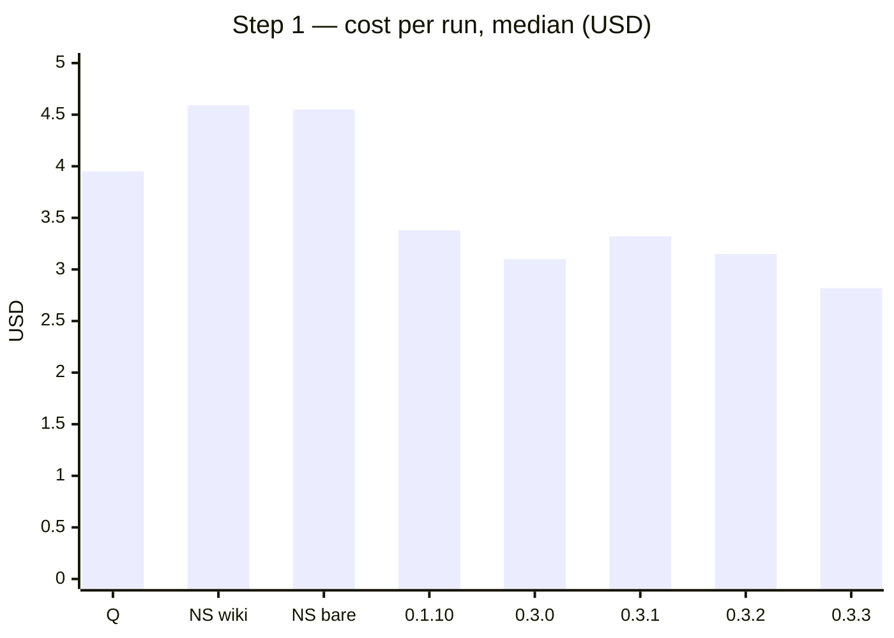
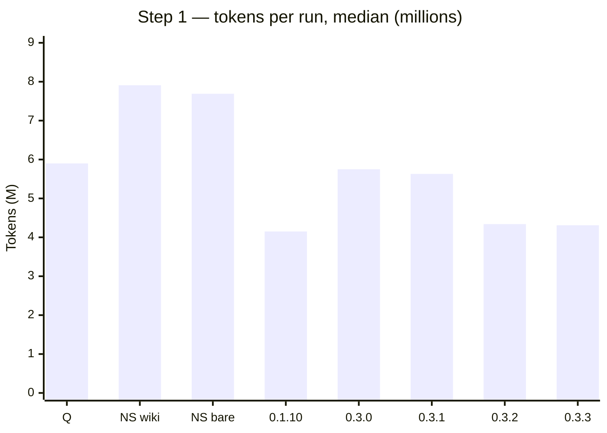
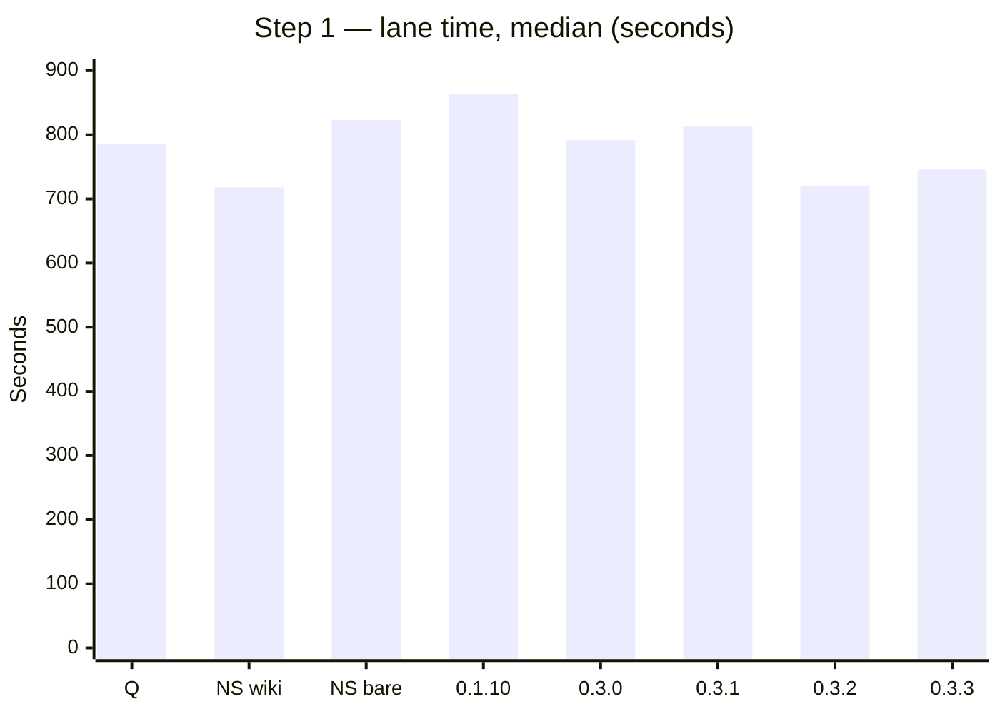
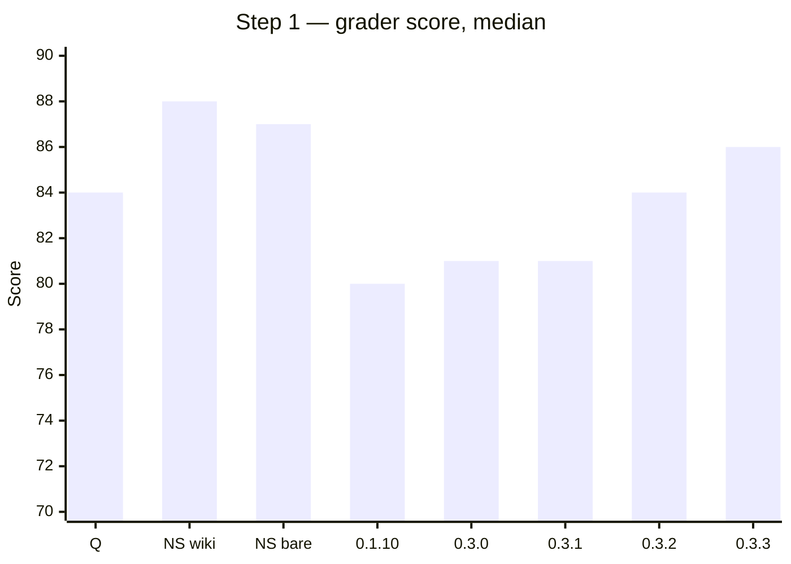

# Benchmark — Light ORC vs /orc-quick

[← README](../README.md)

**Method.** Company Vue repo. 3 runs per cell. The table shows medians. The main model is the same in every arm: Opus 5.5 medium. ORC 2.3.0 freeze. Date: 11–14-10-2026.
`/orc-quick` uses its pinned executor, Opus 5.5 low. lorc picks its own executor.
Arms: Q = `/orc-quick`. LS = lorc alone. LO = lorc with ORC installed.
Gate per cell: cost lower AND tokens lower AND lane time lower AND score median not lower than Q AND the critical e2e steps pass in 3 of 3 runs.

## Step 1 (RMT1) — lorc 0.3.x, `/orc-quick` and no skill

Arms: Q = `/orc-quick` (3 runs). LS = lorc alone (3 runs per version). No skill = plain Claude Code, same model and
effort, no lorc and no ORC: "wiki" keeps the committed wiki and CLAUDE.md, "bare" removes the wiki (1 run each).

| Arm | Lane s | Cost $ | Tokens | Fresh | Score | E2E pass |
|---|---|---|---|---|---|---|
| Q (`/orc-quick`) | 785 | 3.95 | 5.90M | 302.3k | 84 | 3/3 |
| No skill, wiki | 718 | 4.59 | 7.91M | 291.0k | 88 | 1/1 |
| No skill, bare | 823 | 4.55 | 7.69M | 277.8k | 87 | 1/1 |
| LS 0.1.10 | 864 | 3.38 | 4.15M | 333.0k | 80 | 2/3 |
| LS 0.3.0 | 792 | 3.10 | 5.75M | 358k | 81 | 3/3 |
| LS 0.3.1 | 813 | 3.32 | 5.63M | 366k | 81 | 3/3 |
| LS 0.3.2 | 721 | 3.15 | 4.34M | 349k | 84 | 2/3 |
| **LS 0.3.3** | **746** | **2.82** | **4.31M** | **332k** | **86** | **3/3** |

The same medians as charts (Q = `/orc-quick`, NS = no skill). Lower is better for cost, tokens and lane time; higher is
better for the score.

lorc 0.3.3 compared with each arm (lane / cost / tokens / score):

| Against | Lane | Cost | Tokens | Score |
|---|---|---|---|---|
| Q (`/orc-quick`) | −5 % | −29 % | −27 % | +2 |
| No skill, wiki | +4 % | −39 % | −46 % | −2 |
| No skill, bare | −9 % | −38 % | −44 % | −1 |
| LS 0.1.10 | −14 % | −17 % | +4 % | +6 |

**Gate (RMT1, LS 0.3.3 vs Q): PASS** — cost, tokens and lane time lower, score not lower, e2e 3 of 3. This is the first
pass on step 1.

0.3.3 runs: 805 s / $2.89 / 4.31M / 86 · 746 s / $2.82 / 4.51M / 88 · 692 s / $2.50 / 3.70M / 84. All 3 asked the route
path in L3 and chose `outwards/create`. All e2e runs passed 12 of 12 steps and 30 of 30 checks.

What changed from 0.3.0 to 0.3.3, and why:
- 0.3.1: `lorc cov` splits source branches from generated branches. The 0.3.0 runs lost points in 3 of 3 runs to a
  branch-coverage number (83.33 %) that came from Babel helper code on an import line. 0.3.1: 0 of 3.
- 0.3.2: a broken source map is a `tool_limit`, not a finding. In one 0.3.1 run the reviewer read it as "coverage not
  proven" and the lane spent a whole turn measuring coverage (7.37M tokens). Also: an unmet acceptance item is P1, and an
  executor never deletes a failing test.
- 0.3.3: prep `must_ask` gives the route path of a new page as a required question, with the paths that the repo already
  names (router comment, tests). One 0.3.2 run, and one 0.1.10 run, made up a route path, and the e2e failed.

Limits of this comparison:
- The no-skill arms ran once each, in an earlier round of the same kit, with an older check set (26–27 checks; now 30).
  The model, the effort and the Claude Code version (2.1.288) are the same. Read their scores as approximate.
- lorc uses more FRESH input tokens than plain Claude Code (332k against 278k–291k). It saves on cache reads.
- A second grade of the same run moved the score by up to 3 points.

Version measured in the table below: 0.1.10 (both steps).

| Step | Arm | Lane s | Cost $ | Tokens | Fresh | Peak ctx main / agent | Turns | Subagents | Score | E2E pass | Δ lane / cost / tokens / score vs Q | Gate |
|---|---|---|---|---|---|---|---|---|---|---|---|---|
| RMT1 | Q | 785 | 3.95 | 5.90M | 302.3k | 108.4k / 143.7k | 3 | 1 | 84 | 3/3 | — | — |
| RMT1 | LS | 864 | 3.38 | 4.15M | 333.0k | 77.6k / 130.1k | 3 | 4 | 80 | 2/3 | +10 % / −14 % / −30 % / −4 | FAIL |
| RMT1 | LO | 740 | 3.60 | 4.79M | 419.4k | 98.6k / 135.3k | 2 | 4 | 76 | 2/3 | −6 % / −9 % / −19 % / −8 | FAIL |
| RMT3 | Q | 962 | 4.09 | 6.65M | 291.8k | 116.6k / 116.4k | 3 | 1 | 84 | 3/3 | — | — |
| RMT3 | LS | 690 | 2.52 | 4.10M | 285.1k | 71.6k / 124.2k | 2 | 2 | 84 | 3/3 | −28 % / −38 % / −38 % / 0 | PASS |
| RMT3 | LO | 546 | 2.34 | 3.04M | 285.9k | 85.2k / 114.2k | 2 | 2 | 84 | 3/3 | −43 % / −43 % / −54 % / 0 | PASS |

**Gate verdicts.** RMT3 LS PASS · RMT3 LO PASS · RMT1 LS FAIL (time, score, e2e) · RMT1 LO FAIL (score, e2e).

RMT1 fails for two reasons. One LS run put the route on a path that the request did not ask for. One LO run used an SCSS variable that does not exist, so the app did not start.

**Earlier versions** (score per run, PASS count):

| Version | Step | LS scores | LO scores |
|---|---|---|---|
| 0.1.8 | RMT1 | 85, 84 (2 PASS of 2) | 82, 82, 83 (3 PASS of 3) |
| 0.1.10 | RMT1 | 80, 58, 83 (2 PASS of 3) | 76, 83, 45 (1 PASS of 3) |
| 0.1.9 | RMT3 | 85, 87, 81 (3 PASS of 3) | 82, 72 (1 PASS of 2) |
| 0.1.10 | RMT3 | 84, 85, 84 (3 PASS of 3) | 85, 84, 77 (2 PASS of 3) |

0.1.8 has the better quality on RMT1. On RMT3, 0.1.9 and 0.1.10 are almost equal.

**About later versions.** Step 1 was re-run on 0.3.0–0.3.3 (table above). Step 2 (RMT3) and the LO arm are not re-run after 0.1.10.

**Grader noise.** A second grade of the same run moved the score by up to 3 points. Gaps of 1–3 points are inside the noise.

The raw data is in the eval kit.

